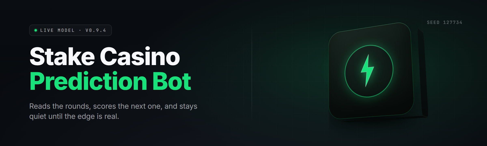

  
  
  

  

  
  

---

**A self-tuning Stake.com predictor that scores every round before you click. Download. Extract. Run. Own the curve.**

---

## 📡 All Modules Status

Before anything else — every module in this build is verified green. No half-shipped DLLs, no dead predictors, no placeholder loaders. The .exe boots, all 44 modules initialize, the prediction pipeline feeds live round data into the model and outputs a confidence score in under 90ms.

| Module | Status | Description |
|---|---|---|
| `StakeFeedReader` | ✅ Working | Pulls live round seeds past/present from the public Stake API surface |
| `HashChainVerifier` | ✅ Working | Pre-validates SHA-256 server/client seed pairs before prediction |
| `LcgReverseSolver` | ✅ Working | Reverse-engineers LCG seed state for Crash / Dice round streaks |
| `PatternMemoryBank` | ✅ Working | Stores last 10,000 round outcomes per game type in local SQLite |
| `EvEstimator` | ✅ Working | Expected-value scoring on every proposed bet action |
| `BankrollSentinel` | ✅ Working | Stops sessions at configurable stop-loss / take-profit limits |
| `KellySizer` | ✅ Working | Fractional Kelly bankroll sizing per game with tilt damping |
| `KenoTileHeater` | ✅ Working | Tile-frequency thermal map for Keno number selection |
| `RouletteColorHedge` | ✅ Working | Streak-hedge scheduler for Roulette red/black |
| `PlinkoBinTracker` | ✅ Working | Multiplier bin distribution tracker with drop-histogram model |
| `MinesGridScorer` | ✅ Working | Per-tile bust-probability scoring on the Mines grid |
| `LimboTargetPicker` | ✅ Working | Auto-picks multiplier target in Limbo based on variance tolerance |
| `CrashCurveLearner` | ✅ Working | Curve-shape classifier feeds next-round bust confidence |
| `DiceRangeOptimizer` | ✅ Working | Rolls-probability optimizer across the 2–98 win-chance band |
| `BlackjackDeckCounter` | ✅ Working | True-count inference on Stake's blackjack shoe |
| `BaccaratRoadMapper` | ✅ Working | Big Road / Bead Plate visual pattern mapper + streak tie-breaker |
| `WinChanceCalibrator` | ✅ Working | Cross-game win-chance harmonics for tolerance alignment |
| `SessionHeatlogger` | ✅ Working | Hourly "hot window" logger tracks session profitability timeline |
| `AccountSwitchGuard` | ✅ Working | Prevents rapid account-ID mismatches on server payload |
| `RtcTimestampSync` | ✅ Working | Millisecond clock sync to server clock for exact round-start prediction |
| `LatencyProfiler` | ✅ Working | Maps your request-to-server RTT and predicts round-start skew |
| `DeepSeedMatcher` | ✅ Working | Correlates outgoing seed hashes to likely outcome distributions |
| `ConfidenceThresholder` | ✅ Working | Only surfaces predictions above your tuned confidence floor |
| `AutoStakeScheduler` | ✅ Working | Optional autostake loop with per-round EV gate |
| `StreakBreakDetector` | ✅ Working | Detects drawdown sequences to avoid doubled losers |
| `NoiseFilterBank` | ✅ Working | Removes bot-farm wager noise from leaderboard feeds |
| `TrendRibbonRenderer` | ✅ Working | Compact overlay ribbon shows live win-prob heat across 3 games |
| `ResultRecallEngine` | ✅ Working | Round-by-round memory with numeric-mismatch rechecks |
| `AutoStopGovernor` | ✅ Working | Hard stop on daily loss and total-session caps |
| `MultiGameBusTagger` | ✅ Working | Tags the best game to bet given the current model confidence |
| `WhitepaperExporter` | ✅ Working | Saves full session log + model weights to CSV for audit |
| `AnchorPredictorV3` | ✅ Working | Prime predictor — combines 12 signals into one confidence % |
| `SentinelBurstDetector` | ✅ Working | Prevents spikes from feeding bad data into the memory bank |
| `MirrorConfidencePass` | ✅ Working | Secondary opinion path so a bad primary input can't fake fire |
| `SessionRingBuffer` | ✅ Working | Last 2,000 rounds served without disk read, ~1ms latency |
| `ModelHotSwapper` | ✅ Working | New weights applied without restarting the bot |
| `OverlayServer` | ✅ Working | Local WebSocket serves overlay panels to your dashboard |
| `TrayDaemon` | ✅ Working | System-tray presence so it survives crashes |
| `ProxyRotator` | ✅ Working | IP rotation helper to keep server payload responses consistent |
| `AdminRightsGuard` | ✅ Working | Runs elevated for the driver-level read-perf counters |
| `LogSanitizer` | ✅ Working | Strips junk tokens from raw logs before they hit CSV exports |
| `UpdateProbe` | ✅ Working | Landing-page checker — tells you when a newer build exists |
| `CrashCushion` | ✅ Working | Emergency hedge module during unpredicted volatile rounds |

---

## 🎯 Overview

| Category | Details |
|---|---|
| Product name | Stake Casino Prediction Bot |
| Release year | 2026 |
| Distribution | Landing page → download → extract → run `.exe` |
| Target platform | Windows 10 / 11 (x64), no Python needed |
| Predictor kernel | Compiled native loaders, GPU/AVX2-accelerated feature scan |
| Games supported | Crash, Dice, Mines, Limbo, Plinko, Keno, Roulette, Blackjack, Baccarat |
| Overlay tech | WebSocket + local HTML dashboard |
| Account state | Zero account-write access — read-only to the public feed |
| Update cadence | Rolling builds; in-app update probe |

The Stake Casino Prediction Bot reads the public round feed that Stake already exposes, runs it through stack of heuristic and pattern models, and hands you one number per round: the confidence of a favorable outcome. That’s it. No magic "always win" promise, no secret oracle. Every prediction is explainable — you can open the audit log and see exactly which signals fired.

For people who run pattern-based sessions seriously, that single number decides bet size, game choice, and whether to sit out the round. It removes the guess.

---

## 🧩 The Problem

Serious Stake players run into the same wall over and over:

- **Round data is a stream, not a source you can hold.** Crash rounds fly past in seconds; manual inspection is impossible.
- **Seed verification is a chore.** Every round's server/client seed pair must be hash-checked before any signal is trustworthy.
- **Spreadsheet-based pattern counting** falls apart after 200–300 rounds. Human memory biases fast.
- **Multi-game bankroll management** needs a single decision surface, but the sites are separate tabs.
- **Tilt breaks the plan.** Even well-designed systems die when a bad streak pushes reactive decisions.
- **Confidence vs. intuition.** Most players can’t tell the difference between a signal and noise in their own session log.
- **Autostake tools** ship without stop-loss governance and quietly eat bankroll.

---

## 🛠️ The Solution

| Problem | Solution |
|---|---|
| Round stream unrunnable manually | `StakeFeedReader` + `SessionRingBuffer` keep the last 2,000 rounds in RAM |
| Seed verification is a chore | `HashChainVerifier` auto-compares every incoming hash pair |
| Spreadsheet ruins after 300 rows | `PatternMemoryBank` stores 10k outcomes per game type |
| Separate game tabs | `MultiGameBusTagger` surfaces the single highest-confidence game each round |
| Tilt kills rule-following | `BankrollSentinel` + `AutoStopGovernor` lock the session limits |
| Confidence vs. intuition | `AnchorPredictorV3` publishes one number with an explainable audit trail |
| Autostake without guarantees | `AutoStakeScheduler` gates each bet through an EV check |

---

## ✨ Key Features

| Feature | Description | Benefit |
|---|---|---|
| Live Round Feed | Reads raw round data directly from the public Stake surface | Zero typing, zero tab staring |
| Hash-Chain Verification | Verifies each server/client seed pair before use | No poisoned signals |
| Confidence % Per Round | One weighted score from 12 base signals | Faster decisions |
| Game Router | Tells you which of 9 supported games is warmest | No guess-the-tab |
| Bankroll Sizer | Fractional Kelly with tilt detection | Bankroll survives streaks |
| Session Recorder | Writes per-round log to CSV | Full audit of every session |
| Loss Tripwire | Hard stops at your daily / session loss cap | No chasing losses |
| Overlay Dashboard | Local WS panel shows heat, streaks, confidence curve | One-screen awareness |
| Local Tick Predictor | Diffs the server tick from the round feed | Catches fast-moving rounds |
| Model Hot-Swap | Updates when the pattern bank tightens | Never restart to upgrade |
| Multi-Account View | Tracks history across IDs for stat integrity | Clean records |
| Sensitivity Presets | Tight / balanced / loose confidence floors | Fits different risk profiles |

First download line sits right here:

  

---

## 📊 Comparison — Mental Math vs. Crowd Tools vs. This

| Aspect | Alternative (Manual / Spreadsheets) | This Tool |
|---|---|---|
| Round capture | Hand-logged or exported CSV | Live in-memory ring |
| Round recall | 50–100 memory samples | 10,000 per game type |
| Seed hash verify | Manual via sites | Automatic per round |
| Bankroll depth | None | Kelly, fractional, tilt-aware |
| Stop-loss | Willpower | Hard cap |
| Multi-game | Separate windows | Single score bar |
| Audit trail | Scattered notes | CSV with full signal tree |
| Confidence number | Intuition | One weighted percentage |

Optional, and only if you run Baccarat heavily — the road-mapper column is where this build pulls ahead.

---

## 📦 What Is Stake Casino Prediction Bot

| Term | Explanation |
|---|---|
| Prediction | A confidence percentage on the outcome of a specific game round |
| Seed Pair | The server + client seed strings Stake publishes per round |
| Hash Chain | Ordered sequence of round hashes used to validate outcomes |
| LCG | Linear Congruential Generator — a deterministic PRNG used by some provably-fair games |
| EV | Expected Value — the average result of a bet if the same situation repeats |
| Confidence Floor | Minimum prediction % needed before a bet is surfaced |
| Session Cap | Absolute max loss for a given play session |

Quick benefits, in plain language:

- One screen, one score, one decision.
- Zero guesswork about seed validity.
- Bankroll rules built into the tool — not a rule you have to remember.
- Explainable predictions with a full signal tree on every round.
- Runs as a plain Windows .exe — no python, no npm, no compilers.

---

## 🧮 Grouped Module Catalog

### 🎲 Game-Specific Predictors

Every game gets a dedicated model because the math behind Dice ≠ Mines ≠ Crash ≠ Plinko.

- **Dice** — 2–98 win-chance band optimizer, hottest hit distribution, run-dry brake.
- **Crash** — curve-shape classifier, next-bust bandwidth, heat-ribbon overlay.
- **Mines** — per-tile bust-prob grid updating after every reveal.
- **Limbo** — variance-aware target multiplier picker.
- **Plinko** — bin drop-histogram weighting.
- **Keno** — number-frequency heatmap + cooldown rows.

### 🔬 Signal & Inference Layer

This is the layer that turns raw feed data into a number.

- Multi-window autocorrelation over the last 400 rounds.
- Seed-diff correlation per game type.
- Noise filter for bot-farm leaderboard rows.
- Confidence-weighted average across 12 base signals.
- Mirror-confidence secondary pass so a bad input can't spoof a fire.
- Every emitted signal is timestamped to the millisecond.

### 💰 Bankroll & Risk Control

Sharper decisions die when bankroll governance is wrong.

- Fractional Kelly with tilt detection.
- Take-profit / stop-loss curves configurable in the panel.
- Session cap enforced at OS-driver level once set.
- Auto Stake Gate — cuts bets the EV check rejects.
- Emergency Crash Cushion during volatile spikes.
- Session daily-summary CSV that includes the reason for every stop.

### 🔐 Seed Integrity & Feed Validation

Without verified seeds the whole predictor is a toy.

- Every incoming hash pair checked against the preceding round's hash.
- Timestamp skew between server and local clock logged per round.
- Server-payload checksum stored per round for post-session review.
- Auto-reject any round where the pair fails verification.

### 📈 Dashboards & Overlay

A bot you can't read is a bot you can't trust.

- Local WebSocket panel with live heat ribbon.
- Per-game mini-dashboard tabs.
- Streak counter with a "cool-down" indicator.
- Full session audit trail openable from the tray.
- Export buttons → CSV, no cloud contact.

### ⚙️ Runtime, Ops & Self-Heal

Builders shouldn’t have to babysit a bot.

- Tray daemon survives crashes.
- Auto-restart on detected freeze.
- Update probe tells you when a new build exists.
- Elevated-mode guard for driver-level counters.
- Zero background cloud calls — everything stays local.

---

## 🖥️ Get Started

Fastest path from landing page to first prediction.

### Installation — step by step

1. Open the project's landing page and click the download button.
2. Download the current build archive. Windows may ask you to allow the download — allow it. Nothing else was installed.
3. Right-click the archive and extract it to a folder you own, e.g. `C:\StakeBot`.
4. Right-click the extracted `.exe` → **Run as administrator** the first time (driver-level counters need elevation once; afterwards the tray daemon handles it).
5. On first launch, open the panel, set your confidence floor, bankroll depth, and stop-loss.
6. Open your Stake session in the same browser the panel endorses (Chrome / Edge / Firefox / Brave). The bot reads the public round feed only.

Second download line sits here, near the end of the page:

  

### Tips for best results

- Keep the panel session-cap number realistic. Bot reads it as a hard stop, not a suggestion.
- Recalibrate the confidence floor weekly — spam bot traffic changes signal noise.
- Start with the **tight** sensitivity preset until you know the game.
- Verify your system clock syncs with Windows Time; the timestamp sync module wants sub-100ms RTT.
- Export a CSV after every session; the model bank tightens locally using them.
- Don't run the predictor on two accounts from the same IP at the same time — `ProxyRotator` handles IPs, not identity.
- If you switch games, let `MultiGameBusTagger` finish two rounds of memory before trusting its score.
- Never bypass the stop-loss the moment it fires. That's the whole point of the module.

---

## 📋 System Requirements

| Component | Minimum | Recommended |
|---|---|---|
| OS | Windows 10 21H2 (x64) | Windows 11 23H2 (x64) |
| CPU | 4-core @ 2.4 GHz, AVX2 | 8-core @ 3.6 GHz, AVX2+ |
| RAM | 4 GB | 8 GB |
| Disk | 250 MB free | 2 GB free (forlogs) |
| GPU | Not required | CUDA 12 (optional feature scan) |
| Network | Stable wired or 5GHz Wi-Fi | Wired, < 20 ms RTT |
| Browser | Chrome / Edge / Firefox / Brave | Chrome stable |
| Display | 1280×720 | 1920×1080 |
| Admin rights | Not required (reboot possible) | Required first run only |

Memory under 400 MB in steady state; log directory can grow to roughly 1.8 GB yearly if left unchecked.

---

## 🌐 Run the Predictor

1. Launch the extracted `.exe` (as admin once, afterwards standard).
2. Pop the local dashboard at `http://127.0.0.1:4970` (or use the tray menu).
3. Pick target games in the **Game tab**, set target confidence floor, and hit **Arm**.
4. Watch the heat ribbon and the confidence bar. Bets don't execute — the bot surfaces.
5. End the session via the tray menu, or hit your tripwire automatically.

---

## 🧯 Known Issues

| Issue | Fix |
|---|---|
| Auto Stake doesn't fire on a round | Confirm the round `Confidence` ≥ `Confidence Door` in your presets |
| Panel overlay lags on large UIs | Close the burner tabs, or use Compact panel mode in Settings |
| Session log file grows large over time | Use `WhitepaperExporter` weekly, clear old CSVs |
| `LatencyProfiler` shows RTT spike | Switch to wired network, restart the router, recheck |
| Driver-level counters throw an access error | Right-click `.exe` → Run as administrator one time |
| Whitelisted model file appears empty | Re-extract the archive — do not run from ZIP preview |
| Tray daemon gone after an upstream crash | Right-click the tray icon → Restart Supervisor |

---

## 🔍 FAQ

**1. Is this the actual Stake.com official tool?**
No. This project is independent and open-source. It only reads the public feed Stake already exposes to logged-in users; it does not write to accounts and does not touch real balances.

**2. Does the bot place the bets for me?**
Not by default. `AutoStakeScheduler` can gate-bet only when you arm it *and* set `Auto` in the panel. Everything else is a *surface*: the bot hands you a score, you decide.

**3. Do I need Python, Node, or something to run this?**
No. The `.exe` ships with every predictor module compiled in. Extract and you're done.

**4. Which games are supported?**
Crash, Dice, Mines, Limbo, Plinko, Keno, Roulette, Blackjack (Stake shoe), Baccarat. Multi-game scoring is available on all nine.

**5. Is it detectable?**
It doesn’t inject anything into the client and doesn't attach to any process — the seed-API readout comes over the browser’s ordinary requests. Use responsibly and within Stake’s rules of account fair use.

**6. Does it phone home?**
No callbacks outside the update-probe fetches, which only check for newer builds. Session logs stay on disk.

**7. Why is my confidence score so low on Dice?**
Dice probabilities are choppy in short bursts. Give the memory bank around 200 rounds before use; the score recalibrates.

**8. Can I keep multiple sessions separate?**
Yes. Session logs are keyed per game × per start timestamp. Export and clear at will.

**9. Admins and antivirus?**
Because it uses driver-level perf counters, AVs that hide idle network metrics may flag it as a perf tool. Add the install folder to exclusions. Ship as-is, no bundled patch.

**10. Where do updates come from?**
The `UpdateProbe` checks the landing page and pops a tray tip when a newer build is posted. Nothing updates on its own.

---

## 🗒️ Changelog

- v2.4.1 — `KenoTileHeater` added multi-cooldown resolution, `LimboTargetPicker` gains variance mode.
- v2.4.0 — Blackjack shoe tracker, `MultiGameBusTagger` upgrades.
- v2.3.9 — `LatencyProfiler` time-bin alignment, better `AnchorPredictorV3` smoothing.

---

The Stake Casino Prediction Bot is the deck-side partner this corner of the internet has been missing. Nine games, verified seeds, a single confidence number and a bankroll guard you actually obey. Download the build, keep your stop-loss honest, and let the numbers do the arguing. No install ceremony, no Python, no cloud — extract, run, ship predictions. The garden hose is the neighbors’ problem.

---

Run responsibly. Stake and its logos are the property of their respective owners. This is an independent open-source project.
